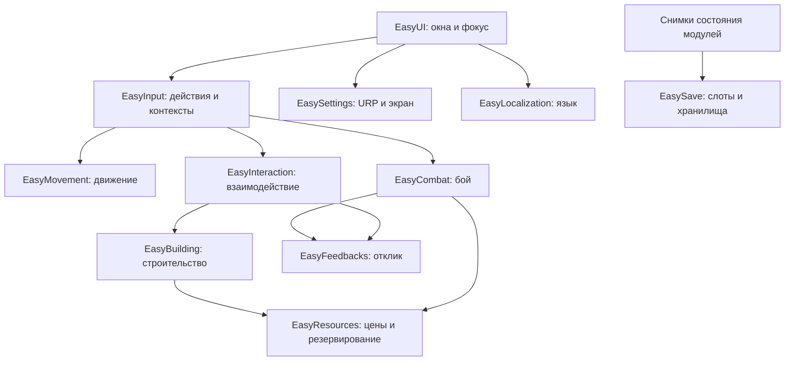

# Первый проект с EasyGameFramework

EasyGameFramework устанавливается одним Unity-пакетом. Внутри находятся 12 модулей. Подключение пакета добавляет компоненты и инструменты; работающие системы появляются, когда вы используете их в сцене или создаёте через API. Импортировать отдельные адаптеры между модулями не требуется.

## Запустить готовый пример

1. Создайте проект Unity 6.3 с URP. Установите свою лицензионную копию ECM2.
2. В Package Manager выберите **Install package from git URL** и укажите URL выпуска из корневого README.
3. В Player Settings установите **Active Input Handling → Input System Package (New)**. Если Unity запросит перезапуск, завершите его.
4. Откройте **Tools → EasyGameFramework → Setup**. Окно автоматически появляется один раз в проекте. Повторно его можно открыть через меню: оно показывает доступность модулей и зависимостей, объясняет проблемы настройки и ведёт к документации.
5. На вкладке Samples импортируйте **Framework Playground**. Затем выберите **Tools → EasyGameFramework → Examples → Create or Update Framework Playground** и нажмите Play.

В Playground: WASD и мышь — движение; E — взять/отпустить предмет; G — бросить; левая кнопка мыши — выстрел или подтверждение постройки; T — каталог строительства; R/Q — поворот; Escape — выход из строительства; Tab — меню. F5/F9 сохраняют/загружают прогресс. Настройки сохраняются отдельными кнопками меню.

Повторное создание уже существующего Playground открывает сохранённую сцену и не сбрасывает ваши правки. Дополнительные Samples нужны только для изучения конкретных механизмов.

## Что где настраивать

| Задача | Модуль |
| --- | --- |
| Игрок от первого лица, Rigidbody-тяга | EasyMovement |
| Здоровье, оружие, статусы, лужи, способности | EasyCombat |
| Выбор и использование объектов, физическое удержание | EasyInteraction |
| Размещение по сетке, свободно, в зонах и сокетах | EasyBuilding |
| Единая база ресурсов, контейнеры, цены, награды и резервирование | EasyResources |
| Звуки, эффекты, музыка, тряска и вибрация | EasyFeedbacks |
| Действия, переназначение, чувствительность, подсказки кнопок | EasyInput |
| Окна, вложенная навигация, диалоги и круговые меню | EasyUI |
| Стандартные таблицы Unity Localization и синхронизация Sheets | EasyLocalization |
| Слоты, файлы, версии данных и протокол восстановления | EasySave |
| Графика URP, экран, подтверждение и отмена | EasySettings |
| Небольшие общие примитивы | EasyCore |

ScriptableObject задаёт исходную конфигурацию: например, характеристики оружия или определение ресурса. Текущее здоровье, баланс, выбранные настройки и другие изменяемые значения принадлежат runtime-объектам. Сохранения получают снимки состояния через публичные API модулей.

## Как соединяются модули

Это схема использования, а не требование создавать все системы в каждой сцене. Например, окно блокирует управление собственным запросом к EasyInput. Закрытие окна освобождает этот запрос; другие открытые окна или причины блокировки продолжают действовать.

Прогресс мира и пользовательские настройки хранятся раздельно. Загрузка игрового слота не должна менять язык, громкость или раскладку игрока. Конкретная игра задаёт момент остановки игрового процесса и порядок восстановления; EasySave не обещает откат произвольных пользовательских побочных эффектов.

## Производительность

Для снарядов по умолчанию выбран Parallel. В Setup можно выбрать Single Thread. Небольшая нагрузка не обязательно выигрывает от Jobs: сравнивайте подходящие вашей игре сценарии. UI, Unity-объекты и настройки рендера обрабатываются на главном потоке. Подробности и ограничения замеров приведены в [Performance.md](Performance.md).

Netcode, XR/VR и AR устанавливаются отдельными дополнениями под конкретный проект. Они требуют настройки платформы, устройств или сетевой модели и собственных проверок.
